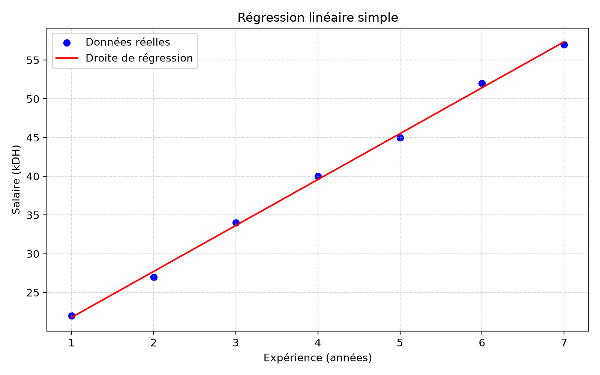

# Simple Linear Regression with scikit-learn

A complete project demonstrating simple linear regression using Python, pandas, matplotlib, and scikit-learn. This study predicts annual salary as a function of years of experience and compares the analytical solution with gradient descent optimization.

## Overview

This project applies the linear model:

h(x) = θ₀ + θ₁x

where:
- x = years of experience
- y = salary in kDH
- θ₀ = intercept
- θ₁ = slope

The workflow includes:
- creating a dataset
- training a LinearRegression model
- evaluating performance using MSE and R²
- plotting the regression line
- comparing the result with SGDRegressor
- analyzing the impact of the learning rate

## Dataset

| Experience (years) | Salary (kDH) |
| --- | ---: |
| 1 | 22 |
| 2 | 27 |
| 3 | 34 |
| 4 | 40 |
| 5 | 45 |
| 6 | 52 |
| 7 | 57 |

## Visual Result



## Project Structure

- `main.py` — full implementation of the exercise
- `README.md` — project documentation
- `regression_lineaire_simple.png` — generated regression plot

## Requirements

Install the required Python packages:

```bash
pip install pandas matplotlib scikit-learn
```

## Step-by-Step Guide

### 1. Clone or open the project

Open the project folder in VS Code or any Python editor.

### 2. Create a virtual environment (recommended)

```bash
python -m venv .venv
```

On Windows:

```powershell
.\.venv\Scripts\Activate.ps1
```

### 3. Install dependencies

```bash
pip install pandas matplotlib scikit-learn
```

### 4. Run the script

From the project root:

```bash
python main.py
```

Or on Windows PowerShell:

```powershell
cd "D:\Travaille EMSI\4IIR G9 - G92 ( 1er Semestre )\Machine Learning\TP\TP 2\linear-regression-sklearn"
.\.venv\Scripts\python.exe main.py
```

### 5. Observe the output

The script prints:
- the dataset
- the optimal coefficients
- the regression equation
- the prediction for 3.5 years of experience
- MSE and R²
- the prediction for 10 years of experience
- the gradient descent comparison for different learning rates

## Key Results

The model produced the following results:

- θ₀ ≈ 15.857
- θ₁ ≈ 5.929
- Equation: h(x) = 15.857 + 5.929x
- MSE ≈ 0.224
- J(θ) = MSE / 2 ≈ 0.112
- R² ≈ 0.998
- Prediction at 3.5 years ≈ 36.6 kDH
- Prediction at 10 years ≈ 75.1 kDH

## Interpretation

The slope θ₁ = 5.929 means that, on average, each additional year of experience is associated with an increase of approximately 5.9 kDH in salary.

The R² value close to 1 indicates that the model fits the data very well.

The 10-year prediction is an extrapolation outside the training range, so it is less reliable than predictions within the observed experience range.

## Gradient Descent Analysis

The script also compares the analytical solution with SGDRegressor using different learning rates.

Examples:

- eta0 = 0.0001 → unstable convergence
- eta0 = 0.01 → close to the analytical optimum
- eta0 = 0.1 → less stable behavior

This demonstrates that learning rate selection strongly affects optimization performance.

## Why This Project Matters

Simple linear regression is one of the foundational models in machine learning. It helps us:
- model a linear relationship between variables
- estimate coefficients analytically or numerically
- evaluate predictive quality
- interpret model behavior in real-world situations

## Troubleshooting

If the plot does not appear:
- make sure matplotlib is installed
- run the script in a graphical Python environment when possible
- or open the generated PNG file in the project folder

## License

This project is intended for educational use.

## Author

Educational machine learning exercise based on simple linear regression.
