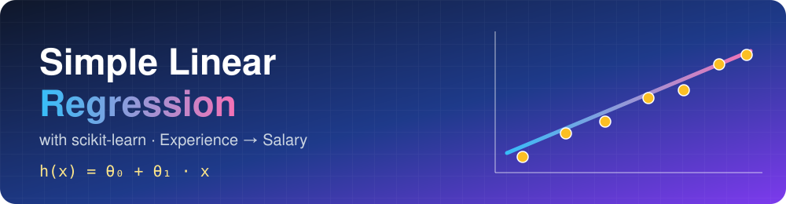
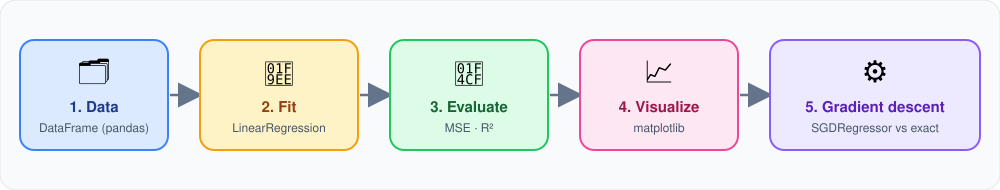
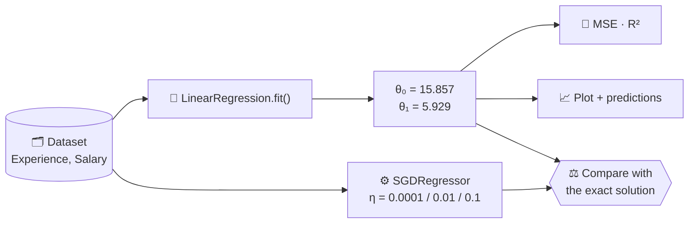
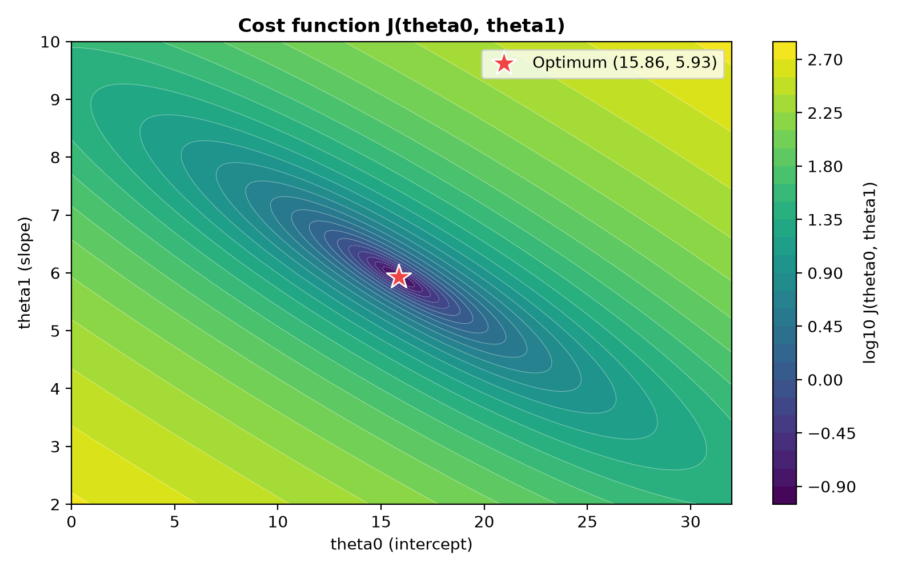
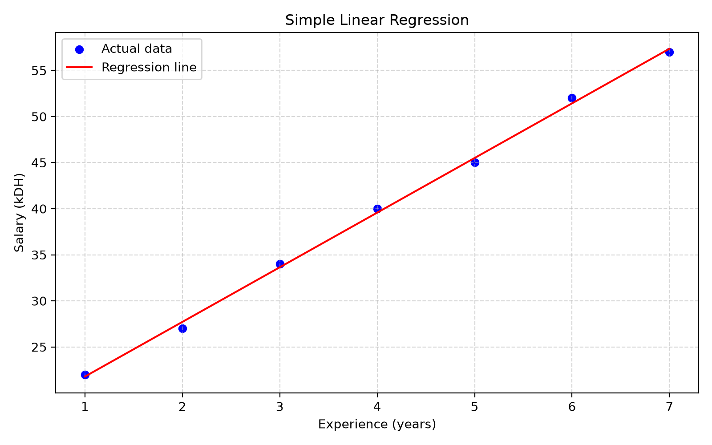
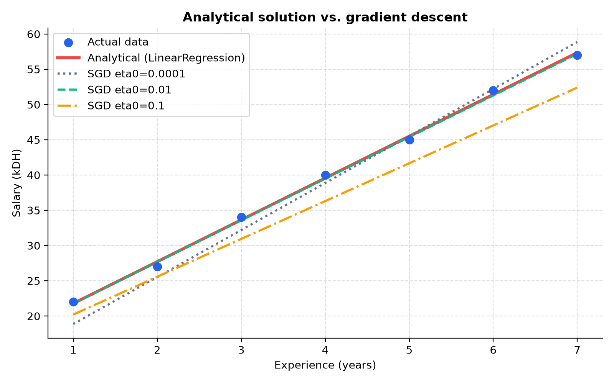
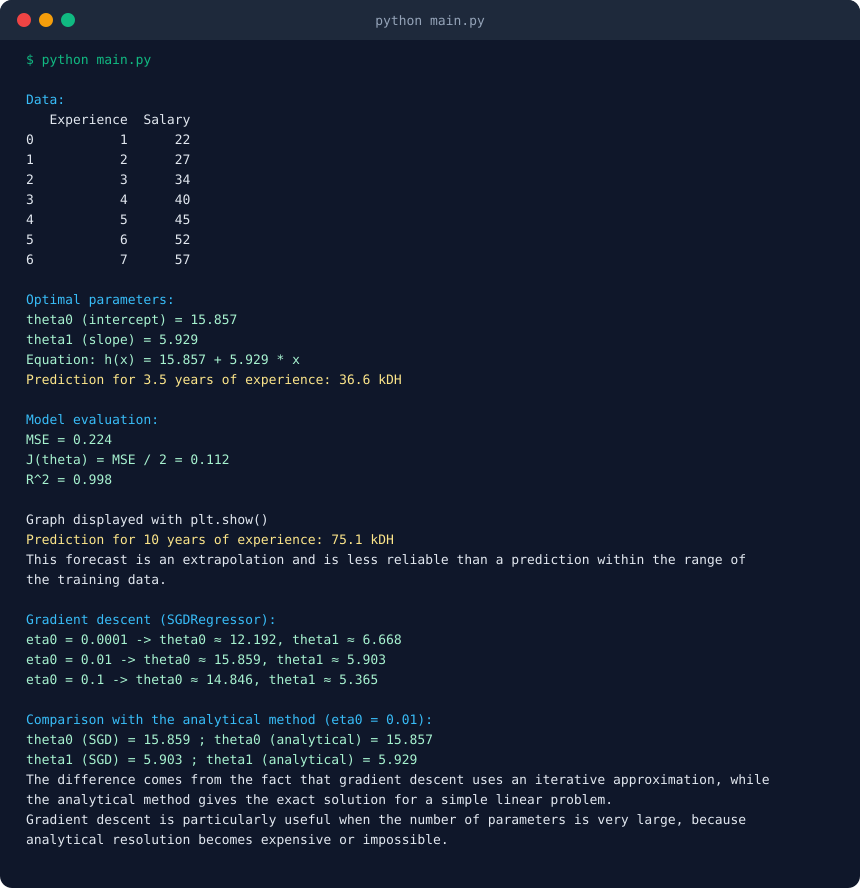
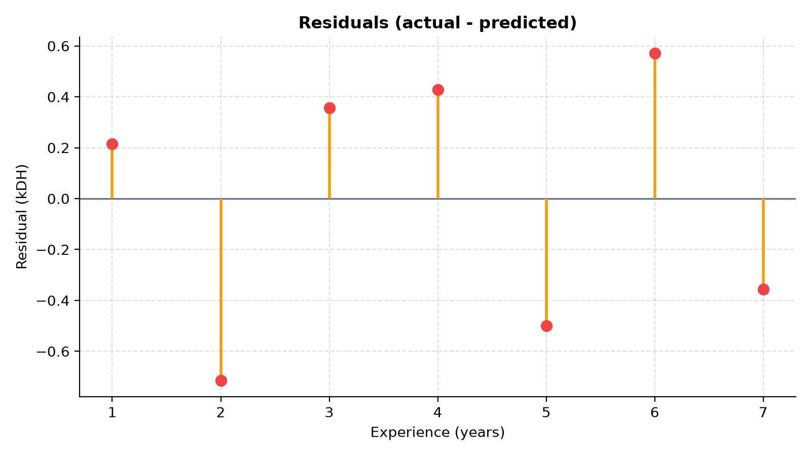

<div align="center">



<br/>


**A complete, step-by-step lab on simple linear regression:**
**predict a salary from years of experience, evaluate the model, plot it, and compare the exact solution with gradient descent.**

[🚀 Quick start](#-quick-start) · [🧭 Step-by-step tutorial](#-step-by-step-tutorial) · [📊 Results](#-results) · [🛠️ Troubleshooting](#%EF%B8%8F-troubleshooting)

</div>


## 📑 Table of Contents

1. [🎯 Objectives](#-objectives)
2. [🗺️ Project overview](#%EF%B8%8F-project-overview)
3. [🧠 The theory in 5 minutes](#-the-theory-in-5-minutes)
4. [📊 The dataset](#-the-dataset)
5. [📁 Project structure](#-project-structure)
6. [🚀 Quick start](#-quick-start)
7. [🧭 Step-by-step tutorial](#-step-by-step-tutorial) *(how to build this exercise from scratch)*
8. [📊 Results](#-results)
9. [🔍 Interpretation](#-interpretation)
10. [⚙️ Gradient descent analysis](#%EF%B8%8F-gradient-descent-analysis)
11. [🛠️ Troubleshooting](#%EF%B8%8F-troubleshooting)
12. [✅ Checklist](#-checklist)
13. [🚧 Going further](#-going-further)
14. [📚 References](#-references)


## 🎯 Objectives

| # | 🎓 Skill | 🔧 Tool used |
|:-:|---|---|
| 1 | Prepare and inspect a small dataset | `pandas.DataFrame` |
| 2 | Estimate the parameters **θ₀** and **θ₁** analytically | `LinearRegression` |
| 3 | Evaluate the model with **MSE** and **R²** | `sklearn.metrics` |
| 4 | Visualize the data and the regression line | `matplotlib` |
| 5 | Make in-range predictions and an extrapolation | `model.predict()` |
| 6 | Compare the exact solution with **gradient descent** | `SGDRegressor` |
| 7 | Interpret the results in a business context | 💼 salary forecasting |


## 🗺️ Project overview






## 🧠 The theory in 5 minutes

### 1️⃣ The model (hypothesis)

We assume a **straight-line** relationship between the input *x* (years of experience) and the output *y* (salary):

$$h_\theta(x) = \theta_0 + \theta_1 x$$

| Symbol | Meaning | Role |
|:-:|---|---|
| `x` | Years of experience | 🔹 feature (input) |
| `y` | Salary in **kDH** (thousands of Moroccan dirhams) | 🔸 target (output) |
| `θ₀` | Intercept | salary at 0 years of experience |
| `θ₁` | Slope | salary increase per extra year |
| `m` | Number of samples (here **7**) | dataset size |

### 2️⃣ The cost function

How "wrong" is a line? We measure it with the (halved) mean of squared errors:

$$J(\theta_0,\theta_1) = \frac{1}{2m}\sum_{i=1}^{m}\bigl(h_\theta(x_i) - y_i\bigr)^2$$

The best line is the pair **(θ₀, θ₁)** that **minimizes J**.

<div align="center">

<br/><sub><b>Figure 1 —</b> J(θ₀, θ₁) is a bowl-shaped (convex) surface: it has a single global minimum (⭐).</sub>
</div>

### 3️⃣ Two ways to find the minimum

<table>
<tr>
<th width="50%">🧮 Analytical (normal equation)</th>
<th width="50%">⚙️ Numerical (gradient descent)</th>
</tr>
<tr>
<td>

Closed-form, **exact**, one shot:

$$\theta_1 = \frac{\sum (x_i-\bar x)(y_i-\bar y)}{\sum (x_i-\bar x)^2}$$

$$\theta_0 = \bar y - \theta_1 \bar x$$

✅ exact · ✅ no hyper-parameters
⚠️ expensive when features are numerous

</td>
<td>

Iterative, **approximate**, small steps downhill:

$$\theta_j \leftarrow \theta_j - \eta\,\frac{\partial J}{\partial \theta_j}$$

✅ scales to huge datasets
⚠️ needs a good learning rate **η**

</td>
</tr>
</table>

### 4️⃣ Evaluation metrics

| Metric | Formula | Reading |
|:-:|:-:|---|
| **MSE** | $\frac{1}{m}\sum (y_i-\hat y_i)^2$ | average squared error — **lower is better** |
| **J(θ)** | $\text{MSE}/2$ | the cost minimized during training |
| **R²** | $1-\frac{\sum (y_i-\hat y_i)^2}{\sum (y_i-\bar y)^2}$ | share of variance explained — **closer to 1 is better** |

> [!NOTE]
> If the math does not render in your viewer, the plain-text version is: `h(x) = θ₀ + θ₁·x` and `J = (1 / 2m) · Σ (h(xᵢ) − yᵢ)²`.


## 📊 The dataset

Seven employees, one feature, one target:

| 👤 Employee | 🧑‍💼 Experience (years) | 💰 Salary (kDH) |
|:-:|:-:|:-:|
| 1 | 1 | 22 |
| 2 | 2 | 27 |
| 3 | 3 | 34 |
| 4 | 4 | 40 |
| 5 | 5 | 45 |
| 6 | 6 | 52 |
| 7 | 7 | 57 |


## 📁 Project structure

```text
linear-regression-sklearn/
│
├── 📄 main.py                  # ▶ Full exercise (Exercises 0 → 4), prints results and saves the plot
├── 📄 generate_assets.py       # 🎨 Regenerates the extra figures and the terminal screenshot
├── 📄 requirements.txt         # 📦 Python dependencies
├── 📄 README.md                # 📘 You are here
├── 📄 .gitignore
│
└── 📂 assets/                  # 🖼️ Images used by this README
    ├── banner.svg
    ├── divider.svg
    ├── pipeline.svg
    ├── regression_plot.png          # written by main.py
    ├── residuals_plot.png           # written by generate_assets.py
    ├── cost_function.png            # written by generate_assets.py
    ├── gradient_descent_comparison.png
    └── terminal_output.svg
```


## 🚀 Quick start

> [!TIP]
> Already comfortable with Python? Four commands are enough.

```bash
# 1. Create and activate a virtual environment
python -m venv .venv
.venv\Scripts\activate            # Windows (PowerShell / CMD)
# source .venv/bin/activate       # macOS / Linux

# 2. Install the dependencies
pip install -r requirements.txt

# 3. Run the exercise
python main.py

# 4. (optional) Regenerate the README figures
python generate_assets.py
```


## 🧭 Step-by-step tutorial

This section explains **how to carry out the exercise from scratch**. Every step shows the code to write and what you should observe. The final result is exactly [main.py](./main.py).

### 🔹 Step 0 — Set up the environment

1. 📂 Create a folder `linear-regression-sklearn` and open it in **VS Code** (or any Python IDE).
2. 🐍 Check your Python version (3.10 or newer):

   ```bash
   python --version
   ```

3. 🧪 Create and activate a virtual environment:

   ```bash
   python -m venv .venv
   .venv\Scripts\activate
   ```

4. 📦 Install the libraries:

   ```bash
   pip install pandas numpy matplotlib scikit-learn
   ```

5. 📄 Create an empty file named `main.py`.

---

### 🔹 Step 1 — Import the libraries

```python
from pathlib import Path

import numpy as np
import pandas as pd
import matplotlib.pyplot as plt
from sklearn.linear_model import LinearRegression, SGDRegressor
from sklearn.metrics import mean_squared_error, r2_score
```

| Import | Why we need it |
|---|---|
| `pandas` | store the data in a table (`DataFrame`) |
| `numpy` | generate the points of the regression line |
| `matplotlib` | draw the charts |
| `LinearRegression` | exact solution (normal equation) |
| `SGDRegressor` | gradient-descent solution |
| `mean_squared_error`, `r2_score` | quality metrics |

---

### 🔹 Step 2 — Exercise 0: prepare the data

```python
df = pd.DataFrame({
    "Experience": [1, 2, 3, 4, 5, 6, 7],
    "Salary":     [22, 27, 34, 40, 45, 52, 57],
})
print(df)

X = df[["Experience"]]   # 2-D feature matrix  -> double brackets!
y = df["Salary"]         # 1-D target vector
```

> [!IMPORTANT]
> scikit-learn expects **`X` to be 2-dimensional** (`n_samples × n_features`). That is why we write `df[["Experience"]]` (a DataFrame) and **not** `df["Experience"]` (a Series). Forgetting the double brackets is the #1 beginner error: `ValueError: Expected 2D array, got 1D array instead`.

✅ **Expected:** a table with 7 rows and the columns `Experience` and `Salary`.

---

### 🔹 Step 3 — Exercise 1: find the optimal parameters (analytical method)

```python
model = LinearRegression()
model.fit(X, y)

theta0 = model.intercept_
theta1 = model.coef_[0]

print(f"theta0 (intercept) = {theta0:.3f}")
print(f"theta1 (slope)     = {theta1:.3f}")
print(f"Equation: h(x) = {theta0:.3f} + {theta1:.3f} * x")
```

| scikit-learn attribute | Mathematical symbol |
|:-:|:-:|
| `model.intercept_` | θ₀ |
| `model.coef_[0]` | θ₁ |

Then predict the salary for **3.5 years** of experience:

```python
x_3_5 = pd.DataFrame({"Experience": [3.5]})
pred_3_5 = model.predict(x_3_5)[0]
print(f"Prediction for 3.5 years: {pred_3_5:.1f} kDH")
```

✅ **Expected:** `θ₀ = 15.857`, `θ₁ = 5.929`, equation `h(x) = 15.857 + 5.929·x`, prediction **36.6 kDH**.

<details>
<summary>🔎 <b>Check it by hand</b> (click to expand)</summary>

With x̄ = 4 and ȳ = 39:

| xᵢ | yᵢ | xᵢ − x̄ | yᵢ − ȳ | (xᵢ−x̄)(yᵢ−ȳ) | (xᵢ−x̄)² |
|:-:|:-:|:-:|:-:|:-:|:-:|
| 1 | 22 | −3 | −17 | 51 | 9 |
| 2 | 27 | −2 | −12 | 24 | 4 |
| 3 | 34 | −1 | −5 | 5 | 1 |
| 4 | 40 | 0 | 1 | 0 | 0 |
| 5 | 45 | 1 | 6 | 6 | 1 |
| 6 | 52 | 2 | 13 | 26 | 4 |
| 7 | 57 | 3 | 18 | 54 | 9 |
| **Σ** | | | | **166** | **28** |

θ₁ = 166 / 28 = **5.929** and θ₀ = 39 − 5.929 × 4 = **15.857** ✔️ — identical to scikit-learn.

</details>

---

### 🔹 Step 4 — Exercise 2: evaluate the model

```python
y_pred = model.predict(X)

mse    = mean_squared_error(y, y_pred)
j_cost = mse / 2
r2     = r2_score(y, y_pred)

print(f"MSE      = {mse:.3f}")
print(f"J(theta) = MSE / 2 = {j_cost:.3f}")
print(f"R^2      = {r2:.3f}")
```

✅ **Expected:** `MSE = 0.224`, `J(θ) = 0.112`, `R² = 0.998`.

> 💡 **Tip:** scikit-learn's MSE has no `½` factor. The course cost function `J` is therefore `MSE / 2`.

---

### 🔹 Step 5 — Exercise 3: visualize the result

```python
plt.figure(figsize=(8, 5))
plt.scatter(X, y, color="blue", label="Actual data")

x_line = np.linspace(X["Experience"].min(), X["Experience"].max(), 100)
y_line = theta0 + theta1 * x_line
plt.plot(x_line, y_line, color="red", label="Regression line")

plt.title("Simple Linear Regression")
plt.xlabel("Experience (years)")
plt.ylabel("Salary (kDH)")
plt.legend()
plt.grid(True, linestyle="--", alpha=0.5)
plt.tight_layout()

out_dir = Path(__file__).parent / "assets"
out_dir.mkdir(exist_ok=True)
plt.savefig(out_dir / "regression_plot.png", dpi=200)   # save BEFORE show()
plt.show()
```

> [!WARNING]
> Call `plt.savefig()` **before** `plt.show()`. After the window is closed, the figure is cleared and you would save an empty image.

✅ **Expected:** blue points almost exactly on a red rising line.

<div align="center">

<br/><sub><b>Figure 2 —</b> Regression line fitted on the 7 observations.</sub>
</div>

---

### 🔹 Step 6 — Make an extrapolated prediction

```python
x_10 = pd.DataFrame({"Experience": [10]})
pred_10 = model.predict(x_10)[0]
print(f"Prediction for 10 years: {pred_10:.1f} kDH")
```

✅ **Expected:** **75.1 kDH**.

> [!CAUTION]
> The data only covers **1 to 7 years**. A prediction at 10 years is an **extrapolation**: the linear trend may not hold outside the observed range (salaries often plateau), so this value is **less reliable** than the one at 3.5 years (an *interpolation*).

---

### 🔹 Step 7 — Exercise 4: gradient descent with `SGDRegressor`

Train the same linear model with **three learning rates** and compare:

```python
learning_rates = [1e-4, 1e-2, 1e-1]

for eta0 in learning_rates:
    sgd_model = SGDRegressor(
        loss="squared_error",        # same cost as linear regression
        penalty=None,                # no regularization
        learning_rate="constant",    # fixed step size = eta0
        eta0=eta0,
        max_iter=10000,
        tol=None,                    # never stop early
        random_state=42,             # reproducible results
    )
    sgd_model.fit(X, y)
    print(f"eta0 = {eta0} -> theta0 ≈ {sgd_model.intercept_[0]:.3f}, "
          f"theta1 ≈ {sgd_model.coef_[0]:.3f}")
```

Then print the comparison with the analytical solution for `eta0 = 0.01`.

✅ **Expected:**

| η (`eta0`) | θ₀ | θ₁ | Verdict |
|:-:|:-:|:-:|---|
| `0.0001` | 12.192 | 6.668 | 🐢 too small → not converged |
| `0.01` | 15.859 | 5.903 | ✅ very close to the exact solution |
| `0.1` | 14.846 | 5.365 | ⚠️ too large → noisy, less accurate |
| *analytical* | *15.857* | *5.929* | 🎯 reference |

<div align="center">

<br/><sub><b>Figure 3 —</b> The green dashed line (η = 0.01) sits on top of the exact red line.</sub>
</div>

---

### 🔹 Step 8 — Run everything

```bash
python main.py
```

<div align="center">

<br/><sub><b>Figure 4 —</b> Console output of <code>main.py</code>.</sub>
</div>

---

### 🔹 Step 9 — Go one step further: analyze the residuals

A **residual** is `actual − predicted`. Good linear models have small residuals with no obvious pattern.

```python
residuals = y - y_pred
print(residuals.round(3).tolist())
```

<div align="center">

<br/><sub><b>Figure 5 —</b> Residuals stay within ±0.75 kDH and show no clear pattern → a straight line is a good choice.</sub>
</div>


## 📊 Results

| 🏷️ Quantity | 🔢 Value |
|---|:-:|
| Intercept **θ₀** | `15.857` |
| Slope **θ₁** | `5.929` |
| Equation | **h(x) = 15.857 + 5.929·x** |
| MSE | `0.224` |
| J(θ) = MSE / 2 | `0.112` |
| R² | `0.998` |
| Prediction @ **3.5 years** *(interpolation)* | **36.6 kDH** |
| Prediction @ **10 years** *(extrapolation)* | **75.1 kDH** |


## 🔍 Interpretation

<table>
<tr>
<td width="33%" valign="top">

### 🟦 Intercept θ₀ ≈ 15.857

A person with **no experience** is expected to earn about **15.9 kDH**.

</td>
<td width="33%" valign="top">

### 🟥 Slope θ₁ ≈ 5.929

Each **extra year** of experience adds roughly **5.9 kDH** to the salary.

</td>
<td width="33%" valign="top">

### 🟩 R² ≈ 0.998

The line explains **99.8 %** of the variation in salaries — an excellent fit.

</td>
</tr>
</table>

- ✅ **3.5 years → 36.6 kDH** is reliable: it lies *inside* the observed range.
- ⚠️ **10 years → 75.1 kDH** is an extrapolation: treat it as an estimate only.
- ⚠️ A great R² on **7 points, used for both training and evaluation**, does not guarantee good generalization. With more data, split into train/test sets.


## ⚙️ Gradient descent analysis

The learning rate **η** controls the step size at each update:

```text
 η too small          η well chosen          η too large
 ·  ·  ·  ·  ·         ·                      ·       ·
   (crawls,               ·   (converges        ·   ·
    never arrives)          ·    smoothly)       (bounces around /
                              ✔                    diverges)
```

| η | Behaviour | Result on this dataset |
|:-:|---|---|
| `0.0001` | 🐢 Very slow convergence | θ stays far from the optimum |
| `0.01` | ✅ Good balance | Almost identical to the analytical solution |
| `0.1` | ⚠️ Steps overshoot the minimum | Oscillates → less accurate |

**Why use gradient descent if the exact formula exists?** Because the closed-form solution requires inverting a matrix whose cost grows quickly with the number of features. For models with thousands or millions of parameters (deep learning, huge datasets) iterative methods are the only practical option.


## 🛠️ Troubleshooting

<details>
<summary>❌ <code>ModuleNotFoundError: No module named 'sklearn'</code></summary>

Install the dependencies inside the **activated** virtual environment:

```bash
pip install -r requirements.txt
```

The package is called `scikit-learn` but is imported as `sklearn`.

</details>

<details>
<summary>❌ <code>ValueError: Expected 2D array, got 1D array instead</code></summary>

Use double brackets to keep `X` two-dimensional: `X = df[["Experience"]]`.

</details>

<details>
<summary>❌ The plot window does not appear</summary>

- Make sure you run the script in an environment with a display (not a headless server).
- The figure is **always saved** to `assets/regression_plot.png`, so you can open that file directly.
- On a server, run with a non-interactive backend: `MPLBACKEND=Agg python main.py`.

</details>

<details>
<summary>❌ PowerShell refuses to activate the virtual environment</summary>

Allow scripts for the current session, then activate again:

```powershell
Set-ExecutionPolicy -Scope Process -ExecutionPolicy Bypass
.\.venv\Scripts\Activate.ps1
```

Or skip activation and call the interpreter directly: `.\.venv\Scripts\python.exe main.py`.

</details>

<details>
<summary>❌ SGD results differ slightly from the README</summary>

`SGDRegressor` is stochastic. Keep `random_state=42` and the same hyper-parameters to reproduce the tables. Tiny differences between scikit-learn versions are normal.

</details>


## ✅ Checklist

- [x] Environment created and dependencies installed
- [x] Dataset loaded into a `DataFrame`
- [x] Parameters θ₀ and θ₁ found with `LinearRegression`
- [x] MSE, J(θ) and R² computed
- [x] Regression line plotted and saved
- [x] Predictions made for 3.5 and 10 years
- [x] Gradient descent compared for three learning rates
- [x] Results interpreted

## 🚧 Going further

- 🔀 Split the data into **train / test** sets (`train_test_split`) and compare scores.
- 📉 Plot the **cost J versus iterations** to watch gradient descent converge.
- 🧱 Implement batch gradient descent **from scratch** with NumPy.
- 📊 Extend to **multiple linear regression** (experience + education level + city).
- 🧪 Try **feature scaling** (`StandardScaler`) and see how it helps SGD with large η.
- 🛡️ Explore **Ridge / Lasso** regularization.

## 📚 References

- 📘 [scikit-learn — Linear Models](https://scikit-learn.org/stable/modules/linear_model.html)
- 📘 [scikit-learn — `SGDRegressor`](https://scikit-learn.org/stable/modules/generated/sklearn.linear_model.SGDRegressor.html)
- 📘 [scikit-learn — Regression metrics](https://scikit-learn.org/stable/modules/model_evaluation.html#regression-metrics)
- 📘 [pandas documentation](https://pandas.pydata.org/docs/)
- 📘 [Matplotlib documentation](https://matplotlib.org/stable/)


<div align="center">

### 🏆 Educational project — Machine Learning · Lab 2

Made with ❤️ and 🐍 to learn **supervised learning**, **model fitting**, **optimization** and **evaluation**.

⭐ *If this guide helped you, consider giving the repository a star!* ⭐

</div>
